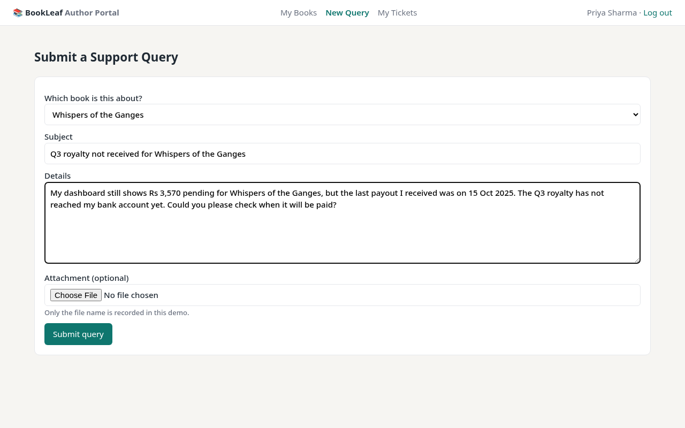
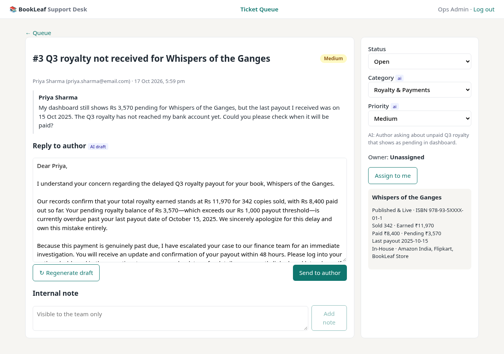
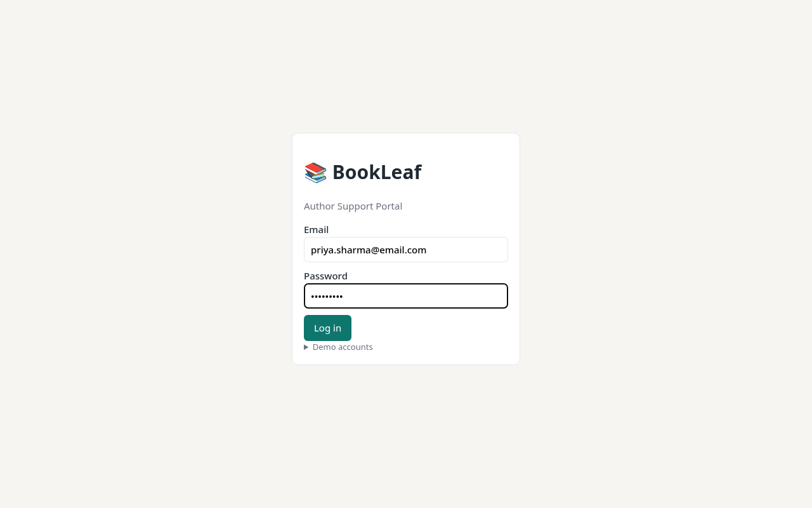
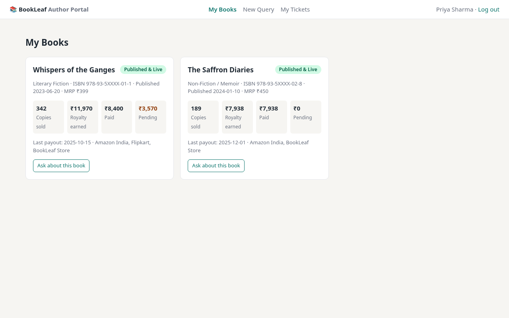
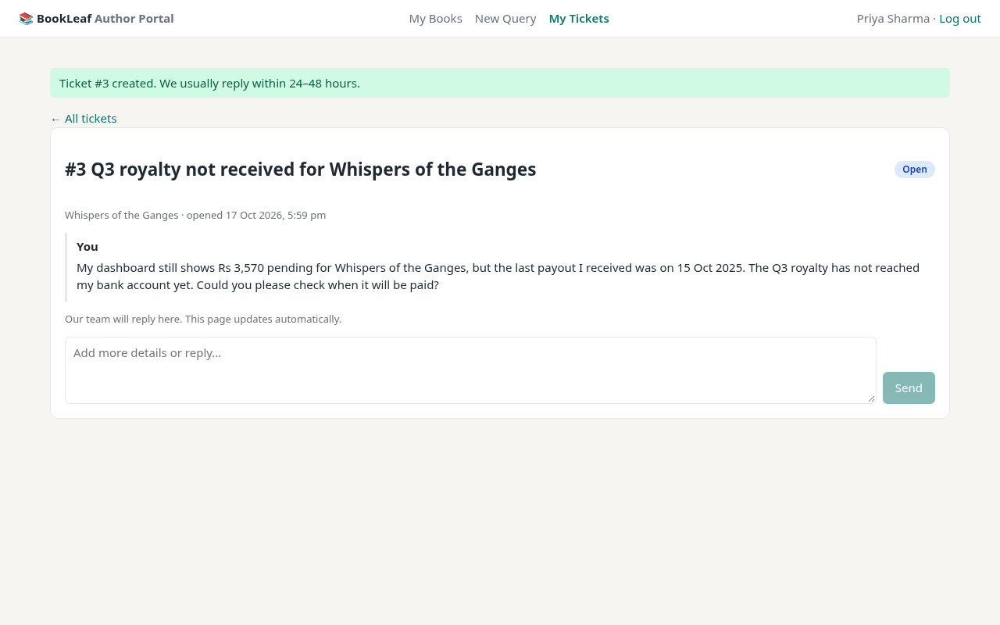
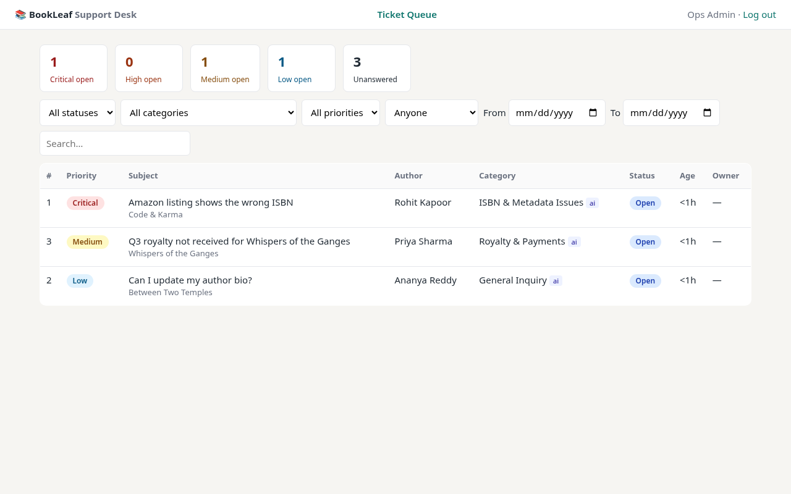
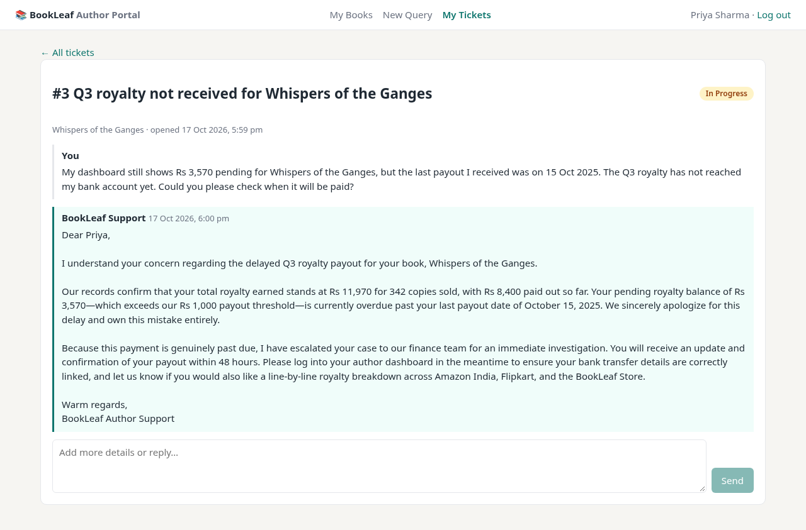

# BookLeaf Author Support & Communication Portal

A web app with an **Author Portal** and an **Admin Support Desk**, with AI-assisted ticket triage and reply drafting grounded in the BookLeaf Knowledge Base.

- **Live demo:** https://bookleaf-support-portal-pi.vercel.app (no Vercel login needed)
  - Author: `priya.sharma@email.com` / `author123`
  - Admin: `admin@bookleafpub.com` / `admin123`
- **API docs:** https://bookleaf-support-portal-pi.vercel.app/docs (Swagger / OpenAPI)
- **Stack:** FastAPI (Python 3.12) · SQLAlchemy 2 · Postgres on Supabase (production) / SQLite (local) · Vue 3 SPA (no build step) · Google Gemini `gemini-3.6-flash` with a keyword/template fallback · hosted on Vercel
- **Write-up:** [WRITEUP.md](WRITEUP.md)

| Author raises a query | Admin: Gemini category, priority, reason and drafted reply |
|---|---|
|  |  |

## Features vs the brief

| Brief requirement | Where / how |
|---|---|
| Email/password login, authors see only their own data | JWT login; every author route is scoped to the caller (others' tickets return 404) |
| My Books (title, ISBN, status, sales, royalties) | **My Books** page, from the provided dataset |
| Submit a support query (book or general, subject, description, attachment) | **New Query** form; attachment is UI-only (file name stored), as the brief allows |
| My Tickets with status and near-real-time replies | **My Tickets** + ticket thread, polling every 4s |
| Ticket queue filterable by status, category, priority, date; urgent/oldest easy to spot | **Ticket Queue** with filters, priority sort, KPI tiles, red edge on >48h unresolved |
| AI auto-classification, admin override | Gemini JSON classification → category + reason; admin can change it (marked `admin`) |
| AI priority score, admin override | Same call returns Critical/High/Medium/Low; overridable |
| AI-drafted response, editable, appears in author thread | Draft grounded in the KB section + the book's real figures; edit → **Send to author** |
| Ticket management: status, internal notes, assign | Status changes, internal notes (never shown to authors), assign/unassign self |
| Clean REST API, auth middleware, RBAC, validation, docs | See [API reference](#api-reference); 401/403/404/422 with one error format; `/docs` |
| AI: prompts, key security, graceful degradation, cost, model choice | See [AI integration](#ai-integration) |

## Test logins (seeded from `bookleaf_sample_data.json`)

| Role | Email | Password |
|---|---|---|
| Author | `priya.sharma@email.com` (any of the 10 author emails in the dataset) | `author123` |
| Author with books in production | `kavita.deshmukh@email.com`, `sneha.kulkarni@email.com` | `author123` |
| Admin | `admin@bookleafpub.com` | `admin123` |
| Admin (2nd agent, to test assignment) | `support@bookleafpub.com` | `admin123` |

## Run locally

```bash
python3 -m venv .venv && source .venv/bin/activate
pip install -r backend/requirements.txt
cp .env.example .env          # optional: add GEMINI_API_KEY; without it the app uses the rules fallback
cd backend
set -a; [ -f ../.env ] && . ../.env; set +a
uvicorn app.main:app --reload --port 8000
```

Open http://localhost:8000 for the app, and http://localhost:8000/docs for the interactive OpenAPI (Swagger) docs. Locally it uses SQLite (`backend/bookleaf.db`), created and seeded automatically on first start; delete the file to reset. Set `DATABASE_URL` to use Postgres instead.

**Tests:** `cd backend && python -m pytest -q` (15 tests). They cover auth, RBAC, validation, the full ticket lifecycle, internal-note privacy, AI fallback on 429/5xx, the Gemini request format, and KB scoping in prompts. AI calls are mocked; no real API is hit.

**Docker:** `docker build -t bookleaf . && docker run -p 8000:8000 -e GEMINI_API_KEY=... -e JWT_SECRET=... bookleaf`.

### Environment variables

| Variable | Required | Purpose |
|---|---|---|
| `JWT_SECRET` | yes in production | Signs login tokens (a dev default is used locally) |
| `DATABASE_URL` | no | Postgres URL (e.g. Supabase transaction pooler, port 6543, `sslmode=require`). Unset → local SQLite |
| `GEMINI_API_KEY` | no | Enables Gemini. Unset → keyword/template fallback |
| `AI_MODEL` / `AI_FALLBACK_MODELS` | no | Default `gemini-3.6-flash` / `gemini-3.5-flash` |
| `OPENAI_API_KEY`, `AI_BASE_URL` | no | Use an OpenAI-compatible API instead of Gemini |
| `SEED_AUTHOR_PASSWORD` / `SEED_ADMIN_PASSWORD` | no | Demo passwords for seeded users (default `author123` / `admin123`) |

### Deployment (Vercel + Supabase)

- `index.py` at the repo root is the Vercel Python entrypoint; it imports the FastAPI app from `backend/`, which also serves the SPA. `vercel.json` sets the framework and bundles `backend/` and `frontend/`.
- The database is a free Supabase Postgres in Mumbai (`ap-south-1`), reached through the transaction pooler. The engine uses no client-side pool and no prepared statements, which is what serverless + a pooler needs.
- On first start, tables are created and the sample data seeded **once**, under a Postgres advisory lock, so concurrent cold starts can't double-seed.
- Row Level Security is enabled on all Supabase tables with no policies, so Supabase's public REST API (anon/authenticated keys) can't read or change any rows. The app connects as its own role that owns the tables, so it isn't affected.
- `JWT_SECRET`, `DATABASE_URL` and `GEMINI_API_KEY` are Vercel environment variables, never in the repo. `/api/health` reports DB and AI status without exposing them.

## Architecture

```
index.py             Vercel entrypoint (imports backend/app/main.py)
frontend/            Vue 3 SPA (index.html, app.js, styles.css), served by FastAPI at /
backend/app/
  main.py            app factory, routers, startup create+seed, static hosting, /api/health
  db.py              engine (SQLite locally, pooler-safe Postgres in production), race-safe init
  config.py          all settings from env vars (API keys never in code or frontend)
  models.py          SQLAlchemy schema (users, authors, books, tickets, ticket_messages)
  schemas.py         Pydantic request/response models = validation + OpenAPI
  security.py        PBKDF2 password hashing, JWT, require_author / require_admin dependencies
  errors.py          uniform error envelope {"error": {code, message, details}}
  api/               thin route handlers: auth.py, author.py (/api/me/*), admin.py (/api/admin/*)
  services/tickets.py  ticket domain logic (create, triage, drafts, replies, filters, serializers)
  ai/                llm.py (provider client), prompts.py, knowledge_base.py (sectioned), rules.py (fallback), service.py (orchestration)
```

**Why these choices**
- **FastAPI:** typed request validation and free OpenAPI docs. Dependencies make auth and RBAC explicit on every route.
- **Schema:** `tickets.category_source` / `priority_source` are `ai | rules | admin`, so admins can see who set a value, and an admin override is never overwritten by a late AI result. Internal notes are `ticket_messages.is_internal=true`. They're filtered out in the author serializer, so they can't leak.
- **Postgres (Supabase) in production, SQLite locally:** the same SQLAlchemy models run on both, so local review needs zero setup and production gets a real, persistent database.
- **Vue without a build step:** the reviewer runs one process. The SPA only talks to the REST API and holds no secrets.
- **Near-real-time via 4s polling:** simplest reliable option behind any host or proxy. It pauses when the tab is hidden. The author sees admin replies and status changes without refreshing. SSE/WebSockets are a drop-in upgrade (see Improvements).

## AI integration

**Flow**
1. **Ticket created:** keyword rules classify it instantly (so a ticket is never unclassified), the API returns 201 immediately, then a **background task** asks Gemini for `{category, priority, reason}` as JSON output. The author never waits on the AI.
2. **Admin opens a ticket:** `GET /api/admin/tickets/{id}/draft` generates a reply draft, **caches it on the ticket**, and returns `source: ai|rules`. "Regenerate" forces a fresh one. The admin edits it and sends it, and it appears in the author's thread.

**Prompt strategy** (`ai/prompts.py`)
- Classification: a system prompt with category definitions and priority rubric taken from the brief's examples (e.g. "no royalty for 6 months" → Critical, "update bio" → Low), `temperature=0`, `max_tokens=80`, and JSON output. The output is **validated against the enum**, and invalid labels fall back to the rules.
- Drafting: the system prompt encodes BookLeaf's tone guidelines (acknowledge first, be specific with real numbers, own mistakes, concrete timelines, clear next step, no AI filler, sign-off). The user prompt has three tagged blocks: `<kb>` (only the relevant section), `<author_data>` (only this ticket's book: sold, earned, paid, pending, last payout, status, partner, platforms), and `<ticket>`. The model is told to use only these facts, which reduces hallucinated promises.

**Cost awareness**
- The KB is **split into sections** (`knowledge_base.py`), and each draft call sends company basics, one category section and tone (~250 tokens) instead of the whole document.
- Only the relevant book's fields are sent, not the author's whole catalogue or ticket history. Descriptions are truncated (1.5k chars for classification, 2k for drafting).
- Classification uses no KB and ~80 output tokens. Drafts are capped at 400 tokens and **cached** (no re-billing on every page view).
- Token usage is logged per call (`bookleaf.ai` logger), for monitoring.

**Graceful degradation**
- On a missing key, timeout, HTTP 404/429 or 5xx, the client retries once, then tries the backup model (`gemini-3.5-flash`), then raises `LLMUnavailable`. Tickets still get created and classified by the keyword rules, and admins get a **template draft filled with the author's real figures**, labelled "Template draft (AI unavailable)". They can always write manually.

**Key security:** the key is read from `GEMINI_API_KEY` (or `OPENAI_API_KEY`) on the server only (`config.py`). It's never sent to the browser and never committed (`.env` is git-ignored, and `.env.example` has no secrets). `/api/health` only reports `ai_enabled`, the provider/model name and DB status.

**Model choice:** Google Gemini `gemini-3.6-flash` via the `generateContent` REST API with JSON output (`responseMimeType: application/json`) for classification and thinking turned off for speed. It's fast, has a free tier, and is good at short, empathetic business writing. If it's overloaded (429/503) or retired (404), the client tries `gemini-3.5-flash` next and then falls back to the keyword/template rules, so a ticket is never blocked on the AI. Setting `OPENAI_API_KEY` (and no Gemini key) switches to any OpenAI-compatible Chat Completions API instead (`AI_BASE_URL`, `AI_MODEL`).

## API reference

All routes except login, health and meta need `Authorization: Bearer <token>`. Errors always look like `{"error": {"code": "...", "message": "...", "details": [{"field","message"}] | null}}` with proper status codes (401 unauthenticated, 403 wrong role, 404 not found, 422 validation). Full schemas are at `/docs` (OpenAPI JSON at `/openapi.json`).

| Method | Path | Role | Description |
|---|---|---|---|
| POST | `/api/auth/login` | public | `{email, password}` → `{access_token, user}` |
| GET | `/api/auth/me` | any | Current user |
| GET | `/api/health` / `/api/meta` | public | Health + AI enabled flag / enum values (statuses, categories, priorities) |
| GET | `/api/me/books` | author | Own books with sales and royalty figures |
| GET | `/api/me/tickets` | author | Own tickets (latest activity first) |
| POST | `/api/me/tickets` | author | Create `{book_id \| null, subject (5–200), description (10–5000), attachment_name?}`. The book must belong to the author |
| GET | `/api/me/tickets/{id}` | author | Own ticket with public messages only (404 for others' tickets) |
| POST | `/api/me/tickets/{id}/messages` | author | Follow-up `{body}`. Reopens Resolved/Closed tickets |
| GET | `/api/admin/tickets` | admin | Queue. Filters: `status, category, priority, date_from, date_to (YYYY-MM-DD), assigned=me\|unassigned, q`. Sorted unresolved → priority → oldest |
| GET | `/api/admin/stats` | admin | Counts by status, and open tickets by priority |
| GET | `/api/admin/tickets/{id}` | admin | Full ticket, book context, messages incl. internal notes |
| PATCH | `/api/admin/tickets/{id}` | admin | `{status?, category?, priority?, assign_to_me?}`. Category/priority changes are marked `admin` |
| GET | `/api/admin/tickets/{id}/draft?regenerate=false` | admin | AI (or template) draft `{draft, source, cached}` |
| POST | `/api/admin/tickets/{id}/responses` | admin | Send reply `{body}`. Visible to the author. Open → In Progress |
| POST | `/api/admin/tickets/{id}/notes` | admin | Internal note `{body}`. Never visible to authors |

## Product touches
- The queue highlights Critical/High tickets and puts a red edge on unresolved tickets older than 48h. KPI tiles show open tickets by priority.
- Badges (`ai` / `rules` / `admin`) show who set each category and priority, and the AI's one-line reason is shown.
- The admin sees the book's royalty and status context next to the draft, so they can verify numbers before sending.
- Edge cases: books in production show "Sales and royalties appear once your book is live". Zero royalties, no payout yet, and empty states are handled. "Ask about this book" pre-fills the form.

## Assumptions
- The dataset has no passwords, so all authors share a seeded demo password (`author123`, configurable via env). Admin users are seeded too.
- Attachments are UI-only (only the file name is stored), as the brief allows.
- Timestamps are stored in UTC and shown in the browser's local time.
- "Assign to themselves" is implemented as assign/unassign self. Reassigning to other agents is a small extension.

## Known limitations / what I'd improve
- Replace polling with SSE or WebSockets plus a pub/sub (Redis) for multi-instance deployments.
- Move AI work to a real queue (RQ/Celery) with retries and dead-lettering. FastAPI background tasks are in-process.
- Alembic migrations (tables are currently created by SQLAlchemy on startup), real file uploads to S3, password reset, rate limiting on login.
- Evaluate classification on a labelled set of real tickets, and track override rate as a quality metric. Feed admin edits back as few-shot examples.
- Retrieval over the full help-centre (embeddings) once the KB grows beyond a few sections. Response caching for near-duplicate queries.
- Email notifications to authors when a reply is sent.

## Screenshots

|  |  |
|---|---|
| **Login** | **My Books:** sales, royalty earned, paid and pending per book |
|  |  |
| **Ticket created:** the author sees it immediately | **Admin queue:** Gemini set each category and priority (`ai` badges); sorted by urgency |
|  | |
| **Author sees the admin's reply** (the Gemini draft, sent from the desk) without refreshing | |

Screenshots were taken from a local run with Gemini enabled and realistic sample tickets.

The approach write-up (one page) is in [WRITEUP.md](WRITEUP.md).
